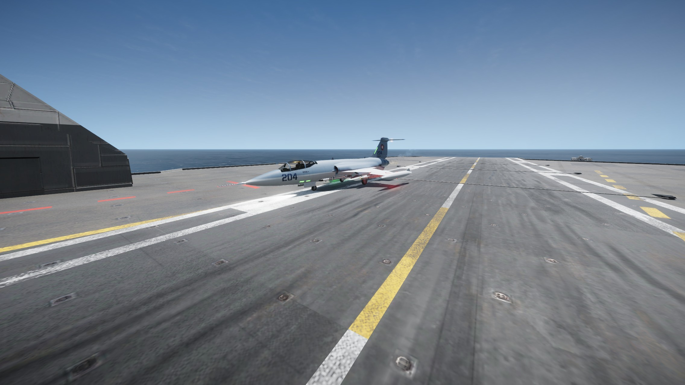
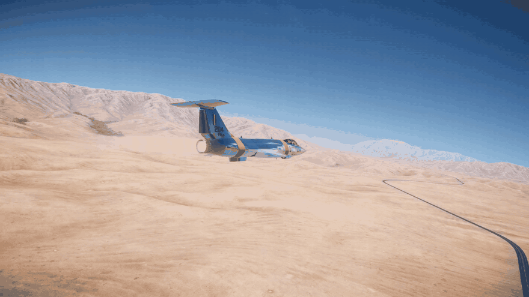
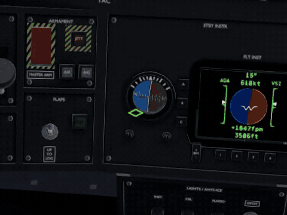
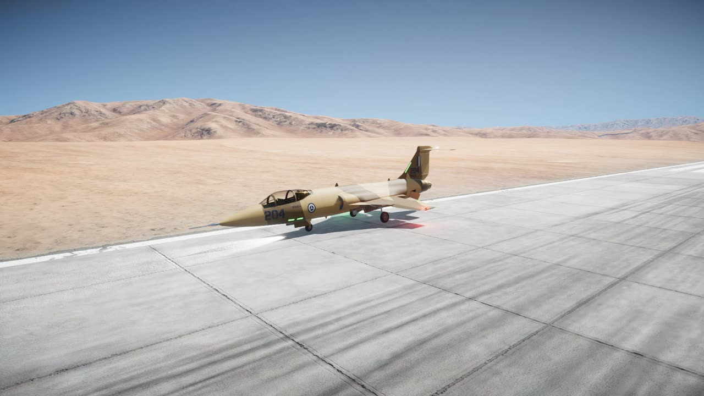
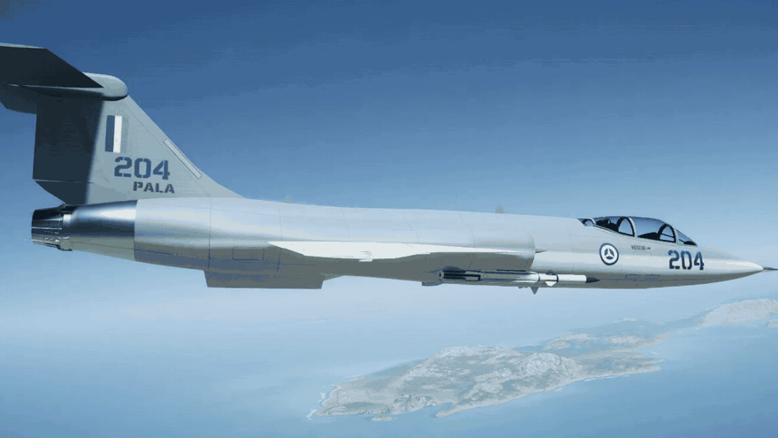
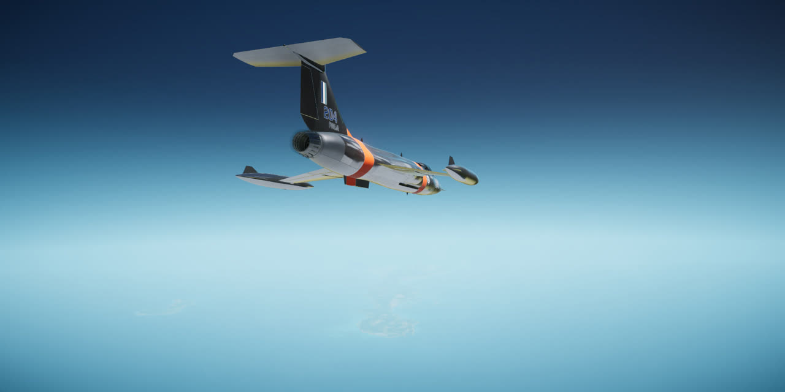
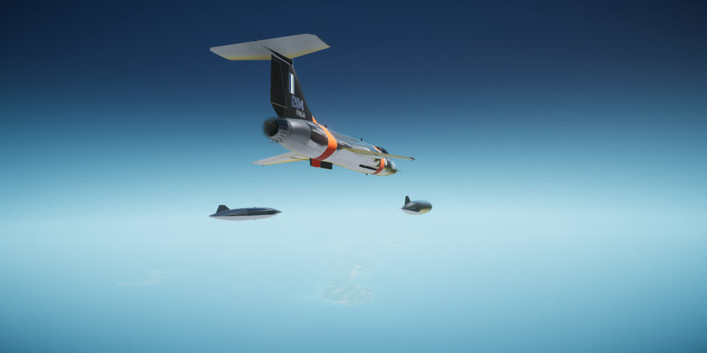
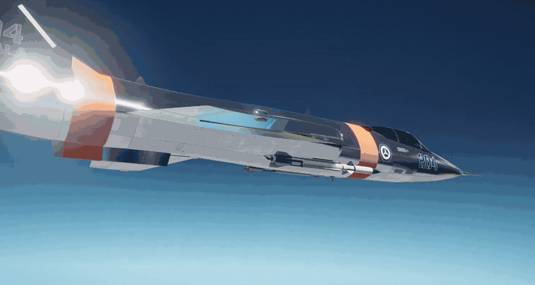
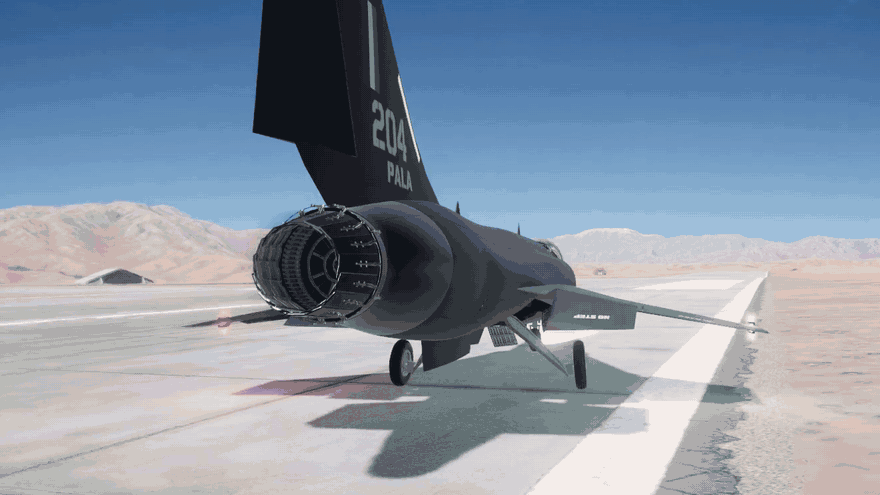

# F-204 Icarus II

A modernized F-104 Starfighter for [Nuclear Option](https://store.steampowered.com/app/2168680/Nuclear_Option/): a Primeva interceptor that runs past Mach 2.6 at 10 km on a modern afterburning turbojet.

Version 0.4.1 is a prerelease. See the [changelog](CHANGELOG.md) for what changed.

## What you get

- A damage model built like the stock jets'. The fuselage and wings break up in whole sections, damage holes show the frames, ribs and spars underneath, and either intake can break away and kill the engine.
- A custom cockpit on the game's own displays and HUD, with a live standby attitude ball, fuel gauge and clock.
- Seven stations: a wingtip that carries a droppable Starfighter tip tank or a missile rail, an underwing pylon and a semi-recessed conformal belly station on each side, and a centreline station for one bomb. Stock weapons, more with the Aryx Weaponry Pack or Meridian Works installed, and no gun.
- Carrier operations from the Hyperion. It spawns on the deck and launches over the ski jump, and an arrestor hook on every standard loadout catches the wire on recovery.
- An iris nozzle that opens with afterburner and vectors thrust up to 4 degrees in pitch and yaw.
- Seven liveries with faction roundels. Primeva gets PALA Navy, Black, Desert and Bare Metal. Boscali gets BDF Matte Gray, Gray Camo and Bare Metal. The aircraft menu opens in your faction's Bare Metal until you pick a livery.
- Its own engine, gear and belly-scrape sounds.

## Requirements

- Nuclear Option. The current build is made against game version 0.34.2.
- [BepInEx 5](https://github.com/BepInEx/BepInEx) installed in the game.
- Blueprinter 2.1.1 or later, which loads the aircraft content.

The mod needs your own copy of the game and uses the game's faction roundels on its liveries.

## Install

### Manual install

1. Download `Icarus-v<version>-plugin-only.zip` from the [releases page](https://github.com/baanish/F-204-Icarus-II/releases). It holds the two files that make up the mod, `Icarus.dll`, the plugin, and `icarus_<version>.nobp`, the aircraft bundle, in `BepInEx/plugins/baanish.icarus/`. To build them yourself instead, follow [BUILD.md](BUILD.md).
2. Close the game.
3. Extract the ZIP into the game folder, so both files land in `BepInEx/plugins/baanish.icarus/`. They only work as a pair, so always replace both together. Keep only one copy. If a second `icarus_<version>.nobp` sits anywhere under `BepInEx/plugins`, Blueprinter skips the duplicate and the Icarus doesn't load.
4. Start the game. `BepInEx/LogOutput.log` names the version on load: `F-204 Icarus II 0.4.1 (baanish.icarus)`.

### Mod managers

The Icarus is listed in NOMM. Install it from there, with BepInEx 5 and Blueprinter 2.1.1 or later installed and Blueprinter enabled.

### Paint your own livery

Download `icarus_livery_kit_0.4.1.zip` from the [releases page](https://github.com/baanish/F-204-Icarus-II/releases). The [livery kit guide](docs/livery-kit/README.md) shows how to paint on the 3D model or a flat template and install the result with the kit's builder.

## Flying it

The Icarus uses the game's normal controls, with no new key bindings.

- **Where to find it.** It is a Primeva aircraft, offered at hardened aircraft shelters and medium hangars. In the stock operations Breakout, Confrontation, Domination, Escalation and Terminal Control, and their co-op versions, Primeva's AI also starts with four, and one Primeva factory per mission builds more. To turn that off, set `StockMissionSupply = false` under `[Missions]` in `BepInEx/config/baanish.icarus.cfg`. The host's setting applies from the next mission load.
- **Loadouts.** Interceptor is the default, with Air Superiority, Strike and Close Support beside it. Interceptor carries the tip tanks, 170 US gal each, which burn before the internal fuel. To drop the pair, select them and fire. Any fuel left in them goes with them. The other loadouts carry an MMR-S3 on each wingtip, and every standard loadout carries AAM-29 Scythes on the conformal stations. The wingtips take the tip tanks, the MMR-S3 or the IRM-S2. The pylon takes one store or a twin air-to-air rack. The conformal stations take the MMR-S3, IRM-S2 and AAM-29.
- **Centreline bomb.** The centreline station takes one GPO-500 or one GPO-N of either yield, on its own pylon between the conformal troughs. It shares the belly with the conformal stations, so the loadout menu greys out the one while the other is loaded: empty the conformal stations to arm the centreline. The bomb hangs about 0.2 m off the ground, so land it gently.
- **Aryx Weaponry Pack.** With the [Aryx Weaponry Pack](https://github.com/Aryx3D/AryxWeaponryPack) installed, the Icarus also carries seven of its weapons. The IRM-S5 Gladius goes on the wingtips, the pylons and the conformal stations, and the MRM-S4 Broadsword on the wingtips and pylons. The pylons also take a twin rack of either missile, the ARAD-45, AGM-27 Pyre, AGR-37 Jester, AGM-76 Atlatl and PGM-400LR. The PGM-400LR also goes on the centreline station. The Jester fits the conformal stations too. The pack is optional: without it the Icarus flies as before, and the game log gains nine "Weapon not found" lines, one for each mount.
- **Meridian Works.** With [Meridian Works](https://github.com/mosdef31/NO-Meridian-Works) installed, the Icarus also carries ten of its weapons. The SRM-8 Kukri and SRM-20 Merlin go on the wingtips, the pylons and the conformal stations. The AAM-63 Falchion, AGM-58, AGM-58F and AGM-190A Black Arrow go on the pylons and the conformal stations. The AAM-120C, AAM-90 Estoc, AAM-7 Sparrow and AGM-33L go on the pylons alone. The pylons take a twin rack of the Kukri, Merlin, AAM-120C, AGM-58, AGM-58F and Black Arrow. The pack is optional, on the same terms as the Aryx one.
- **Conformal missiles drop before they light.** Each slides 1.5 m down out of its trough first, so expect a short pause between the trigger and the motor.
- **It is fast, not agile.** Use speed and climb. It bleeds energy in a sustained turn, and full afterburner empties the internal tanks in about five and a half minutes.
- **Flaps are automatic.** The leading-edge and trailing-edge flaps come out with low airspeed.

### Tuning

The released mod flies on its shipped values and has no diagnostics or tuning settings. A build made with `tools/Build-Icarus.ps1 -Dev` ([BUILD.md](BUILD.md)) adds both.

In a dev build, diagnostic logging is off by default. To enable it, set `StageLogging = true` under `[Diagnostics]` in `BepInEx/config/baanish.icarus.cfg`, then restart the game. Restart after turning it off too, so the diagnostic patches are removed.

The `[Tuning.*]` sections of a dev build's `BepInEx/config/baanish.icarus.cfg` hold the engine, afterburner, thrust vectoring, wing and drag area and AI speed values. Saving the file applies them to every Icarus in flight. A value below 0 means the shipped value. While another player is connected, every machine uses the shipped values. The [vision](docs/VISION.md#tuning) lists what is live and what is not.

## Known issues

- Multiplayer has been tested only with host and client on one PC, not yet on two PCs.
- The flight model was tuned before the latest fuel and tail changes, so takeoff, top speed and handling may drift until it is flown again.
- Rolling hard at high dynamic pressure, above about Mach 1.4 low down, gives a quick yaw twitch that settles within a second.
- Near Mach 2.8 at 60,000 ft the jet can porpoise in pitch by several degrees.
- The flaps, nozzle and canopy move silently. Only the engine, gear and belly scrape have new sounds. The rest keep the stock or donor sounds.
- Small visual gaps remain: a notch shows behind the stabilator at full travel, and a sliver of gear-bay interior can show with the doors open.
- Opening the speed brakes at top speed below about 5 km can tear off the tail cone, from about Mach 1.70 near sea level.
- A heavily loaded AI Icarus often fails to recover aboard the Hyperion carrier.
- About 1 in 8 heavily loaded AI ski-jump launches clips the right wingtip on the carrier's bow.
- The Fun > HelipadSpawn setting is single player only: in multiplayer a joining player's Icarus breaks apart on the pad as it spawns.
- Primeva's AI has been seen fielding and flying the Icarus in Escalation only. The other stock operations load its supply but are not yet checked in play.

## Credits

- The texture source records are in [`art/textures/generated/`](art/textures/generated/). The source images and arrays are in `Icarus-v<version>-texture-sources.zip`.
- The engine sound comes from a public-domain DVIDS hush-house recording of an F110 engine. The gear and scrape sounds are resynthesized from CC0 recordings on Freesound, using [Earshot](https://github.com/Leonxlnx/earshot). [`Audio/CREDITS.md`](unity/Assets/Blueprinter/Mods/icarus/Audio/CREDITS.md) lists every source.
- The cockpit lettering uses the [Barlow](https://github.com/jpt/barlow) font.
- The aircraft is authored onto the game's FS-12 Revoker and loads through Blueprinter.

## Licence

The project is under the [MIT licence](LICENSE). The Barlow font is under the SIL Open Font License ([`art/textures/fonts/OFL.txt`](art/textures/fonts/OFL.txt)), and each audio clip carries the licence its source gave it ([`Audio/CREDITS.md`](unity/Assets/Blueprinter/Mods/icarus/Audio/CREDITS.md)). Nuclear Option and its faction roundels belong to their owners.

## More

- [Vision](docs/VISION.md): the aircraft, its numbers, and how it is built
- [Devlog](docs/devlog/): each stage, what changed and why
- [0.4.0 devlog](docs/devlog/015-structure-and-paint.md)
- [Building from source](BUILD.md)
- [Changelog](CHANGELOG.md)
