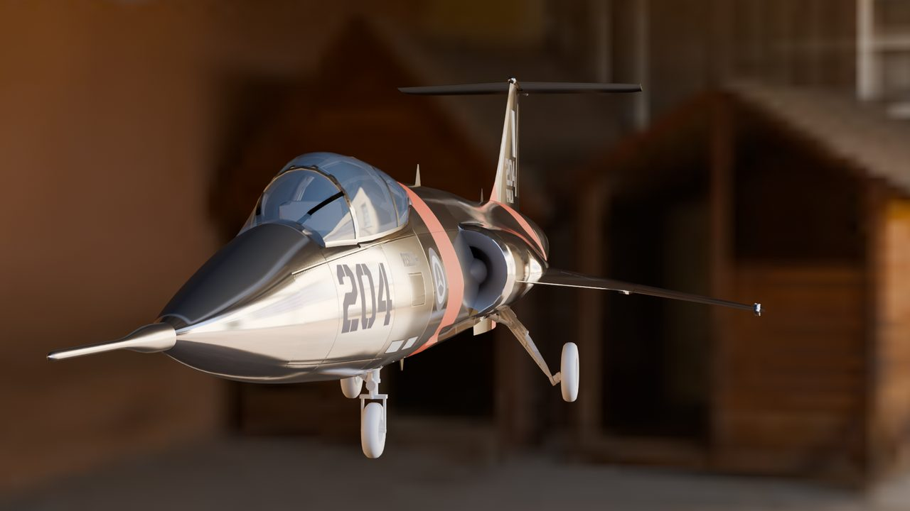
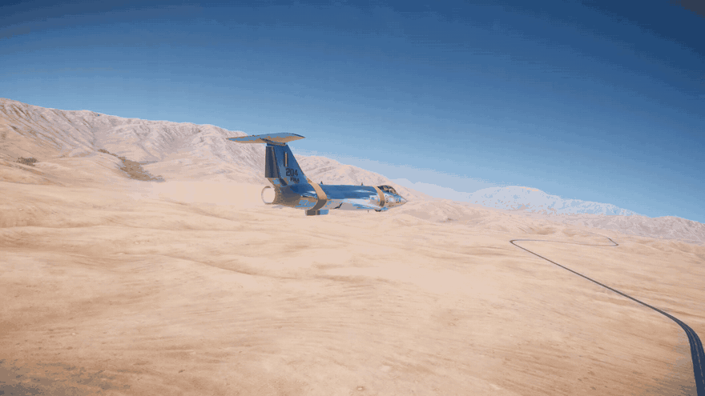
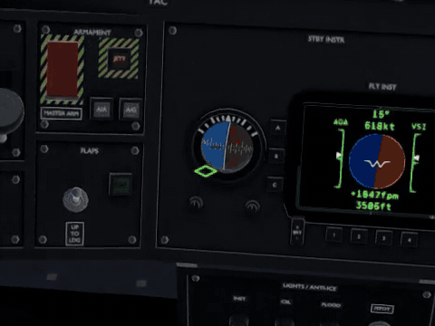
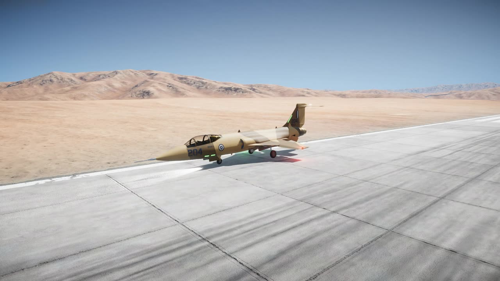
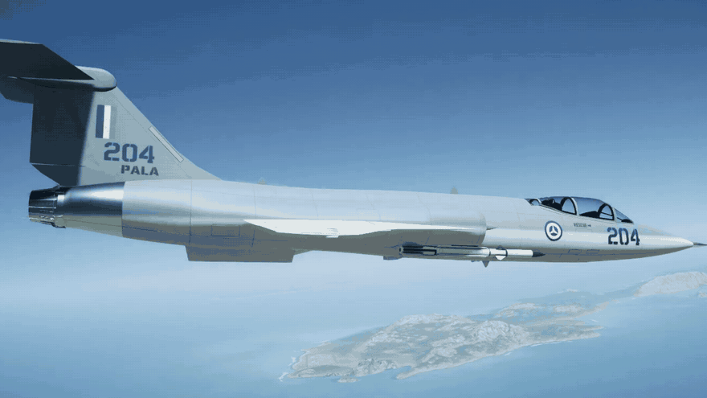
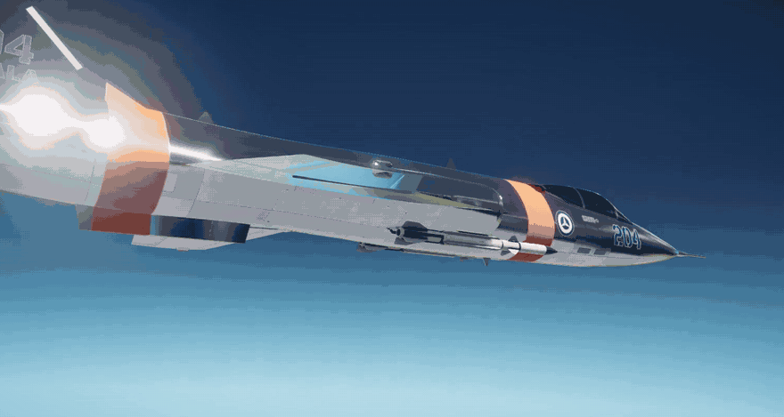
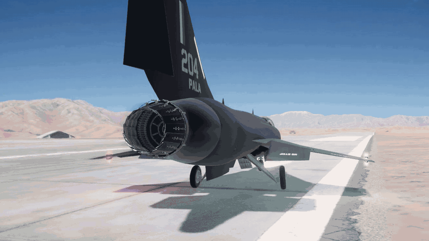

# F-204 Icarus II

A modernized F-104 Starfighter for [Nuclear Option](https://store.steampowered.com/app/2168680/Nuclear_Option/): a Primeva interceptor that runs past Mach 2.5 on a modern afterburning turbojet. It was built by AI agents, with a person reviewing every iteration, and the [devlog](docs/devlog/) shows how.

Version 0.0.1, an early build. It flies, fights and comes apart in game, and it is still being tuned and polished. There is no packaged release yet.

## What you get

- A flyable Primeva jet with a first-pass damage model: breakable parts and internal structure. A missile hit tears off wings, the engine and tail surfaces, and an undamaged airframe holds together in full-stick pulls.
- A custom cockpit on the game's own displays and HUD, with a live standby attitude ball, fuel gauge and clock.
- Six stations: a wingtip that carries a droppable Starfighter tip tank or a missile rail, an underwing pylon and a semi-recessed conformal belly station on each side. Stock weapons only, and no gun.
- An iris nozzle that opens with afterburner and vectors thrust up to 4 degrees in pitch and yaw.
- Four PALA liveries: Navy, Black, Desert splinter, and Bare Metal with high-visibility bands.
- Its own engine, gear and belly-scrape sounds.

## Requirements

- Nuclear Option. The current build is made against game version 0.34.2.
- [BepInEx 5](https://github.com/BepInEx/BepInEx) installed in the game.
- Blueprinter 2.1.1 or later, which loads the aircraft content.

The mod contains no game files. It needs your own copy of the game, whose assets it builds on.

## Install

### Manual install

1. Get the two files that make up the mod: `Icarus.dll`, the plugin, and `icarus_<version>.nobp`, the aircraft bundle. Until there is a packaged release, build them from this repository as [BUILD.md](BUILD.md) describes.
2. Close the game.
3. Copy both files into `BepInEx/plugins/baanish.icarus/` in the game folder. They only work as a pair, so always replace both together.
4. Start the game. `BepInEx/LogOutput.log` names the version on load: `F-204 Icarus II 0.0.1 (baanish.icarus)`.

### Mod managers

NOMM and Thunderstore packages are coming. This section will say how to install from them once they exist.

## Flying it

The Icarus uses the game's normal controls, with no new key bindings.

- **Where to find it.** It is a Primeva aircraft, offered at hardened aircraft shelters and medium hangars. In the stock operations Breakout, Confrontation, Domination, Escalation and Terminal Control, and their co-op versions, Primeva's AI also starts with four, and one Primeva factory per mission builds more. To turn that off, set `StockMissionSupply = false` under `[Missions]` in `BepInEx/config/baanish.icarus.cfg`. The host's setting applies from the next mission load.
- **Loadouts.** Interceptor is the default, with Air Superiority, Strike and Close Support beside it. Interceptor carries the tip tanks, 170 US gal each, burned before the internal fuel; select them and fire to drop the pair, and the fuel left in them goes with them. The other loadouts carry wingtip missiles. The wingtips take the tip tanks, the MMR-S3 or the IRM-S2. The pylon takes one store or a twin air-to-air rack. The conformal stations take the MMR-S3, IRM-S2 and AAM-29.
- **Conformal missiles drop before they light.** Each slides 1.5 m down out of its trough first, so expect a short pause between the trigger and the motor.
- **It is fast, not agile.** Use speed and climb. It bleeds energy in a sustained turn, and full afterburner empties the internal tanks in an estimated six and a half minutes.
- **Flaps are automatic.** The leading-edge and trailing-edge flaps come out with low airspeed.

### Tuning

The `[Tuning.*]` sections of `BepInEx/config/baanish.icarus.cfg` hold the engine, afterburner, thrust vectoring, wing and drag area and AI speed values. Saving the file applies them to every Icarus in flight. A value below 0 means the shipped value. While another player is connected, every machine uses the shipped values. The [vision](docs/VISION.md#tuning) lists what is live and what is not.

## Known issues

- Multiplayer has been tested only with host and client on one PC, not yet on two PCs.
- The flight model was tuned before the latest fuel and tail changes, so takeoff, top speed and handling may drift until it is flown again.
- Rolling hard at high dynamic pressure, above about Mach 1.4 low down, gives a quick yaw twitch that settles within a second.
- Near Mach 2.8 at 60,000 ft the jet can porpoise in pitch by several degrees.
- The flaps, nozzle and canopy move silently. Only the engine, gear and belly scrape have new sounds; the rest keep the stock or donor sounds.
- Small visual gaps remain: a notch shows behind the stabilator at full travel, and a sliver of gear-bay interior can show with the doors open.
- The damage model is a first pass and still needs balancing.
- The stock-mission supply loads, but nobody has yet checked mission by mission that Primeva's AI fields and builds the Icarus.

## Credits

- Made by baanish. Claude and GPT models did the research, art, code and testing, and Grok joined the plan reviews. The [devlog](docs/devlog/) says which model did what.
- Texture base art was drawn by Codex's built-in image generation from the Icarus's own renders and UV layouts. Each generated image sits in [`art/textures/generated/`](art/textures/generated/) next to the prompt that made it.
- The engine sound comes from a public-domain DVIDS hush-house recording of an F110 engine. The gear and scrape sounds are resynthesized from CC0 recordings on Freesound, using [Earshot](https://github.com/Leonxlnx/earshot). [`Audio/CREDITS.md`](unity/Assets/Blueprinter/Mods/icarus/Audio/CREDITS.md) lists every source.
- The cockpit lettering uses the [Barlow](https://github.com/jpt/barlow) font.
- The aircraft is authored onto the game's FS-12 Revoker and loads through Blueprinter.

## Licence

The project is under the [MIT licence](LICENSE). Two parts keep their own licences: the Barlow font is under the SIL Open Font License ([`art/textures/fonts/OFL.txt`](art/textures/fonts/OFL.txt)), and each audio clip carries the licence its source gave it ([`Audio/CREDITS.md`](unity/Assets/Blueprinter/Mods/icarus/Audio/CREDITS.md)). Nuclear Option and its assets belong to their owners. None of them are included here, and the mod needs your own copy of the game.

## More

- [Vision](docs/VISION.md): the aircraft, its numbers, and how it is built
- [Devlog](docs/devlog/): each stage, what changed and why
- [Building from source](BUILD.md)
- [Changelog](CHANGELOG.md)
