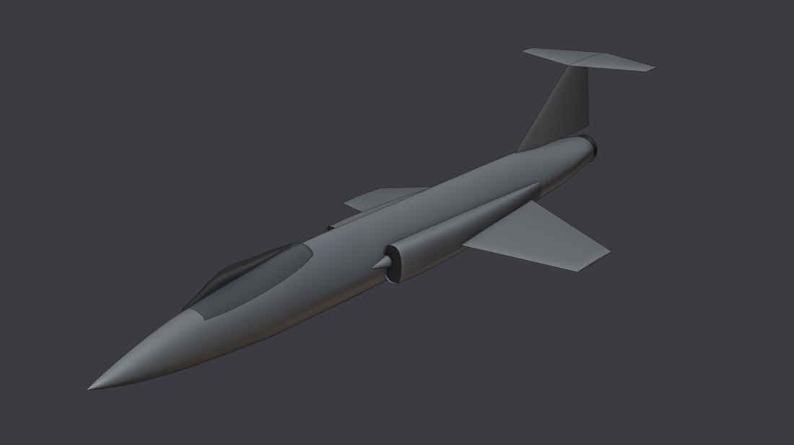
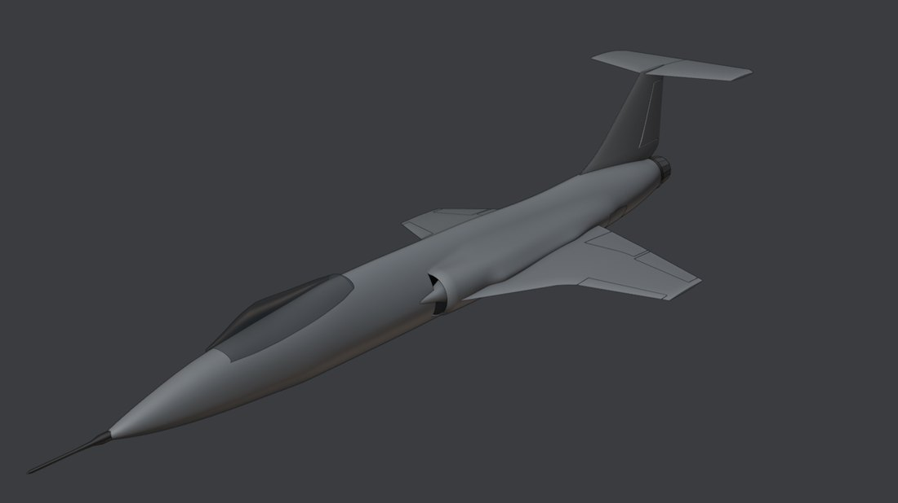
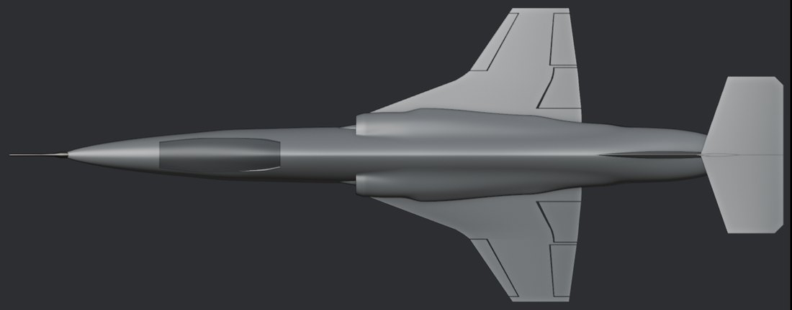
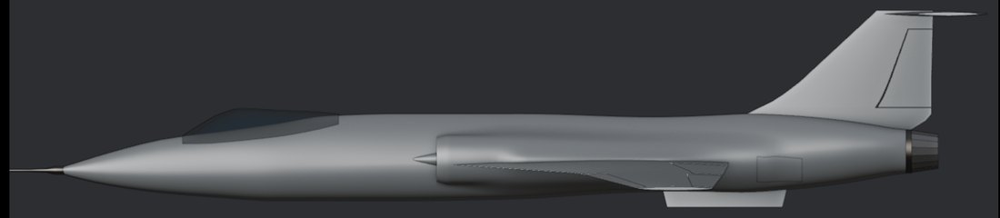
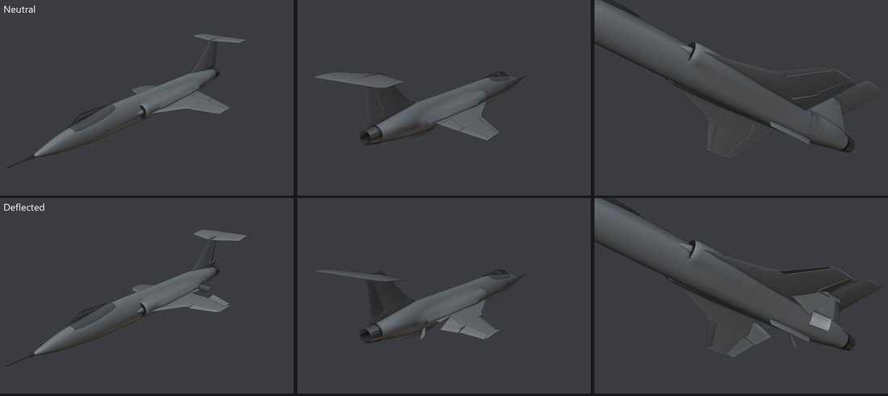
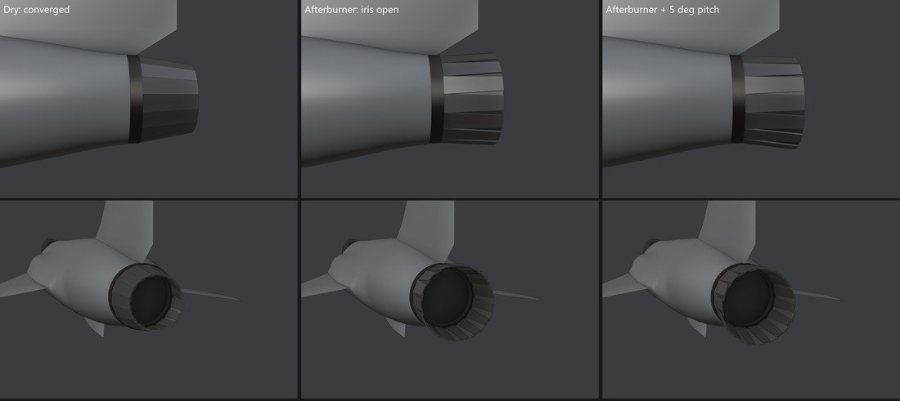
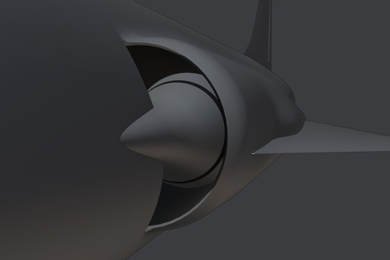

# 002: Silhouette

Sixteen iterations took a faithful F-104G to the Icarus II silhouette. Each one was a parameter change to [the generator](../../art/blender/build_icarus.py), run live in Blender and reviewed by the owner before the next.

The first build was a plain F-104G, checked against three-view drawings to within a few centimetres: 16.69 m long, 6.69 m span, 18.2 m² of wing.

## What changed

- **One skin.** The fuselage stopped being a tube with intake pods stuck on. Each cross-section is now a smooth union of the body, the intake fairings and the wing-root fillet, so they flow into each other. Three bugs taught the rule the generator now follows: a fading shape has to sink inside the body before it disappears, or the blend leaves a bump or a step where it ends.
- **Cranked-arrow wing.** A strake rises from the intake fairing at about 70 degrees, bends at a rounded crank, and runs out to a 35-degree outboard panel. Area went from 18.2 to 20.8 m², and the F-104's 10-degree anhedral and thin wing stayed.
- **Intakes.** Slimmer and rounder, each a slice of a large circle sunk into the fuselage, opening into a modelled duct. The shock cone follows the real F-104's double-shock centre body, a fine tip and then a steeper base, and keeps it fixed.
- **Tail.** The stabilator's V-shaped trailing edge is squared off with a small 45-degree cut at each tip, the fin's root curves down into the spine, and a ventral fin sits on the belly.
- **Area-rule waist.** The whole cross-section pinches about 10 percent along the wing, in plan and in profile. In Nuclear Option it is a look only: the game's drag has no cross-section term.

## Moving parts

Every moving part hangs on a named hinge, ready for the game: leading-edge flaps, trailing-edge flaps, ailerons, rudder, the all-moving stabilator halves, and speed brakes on the aft fuselage.

The nozzle is an iris of 16 petals and 16 seals. It opens for afterburner and tilts a few degrees for thrust vectoring, using the same formula the plugin will run in game.

Next: a rough version in game, to check scale, the pilot's eye point, gear and camera, and to fly the first-cut flight model before the wing shape is frozen.
