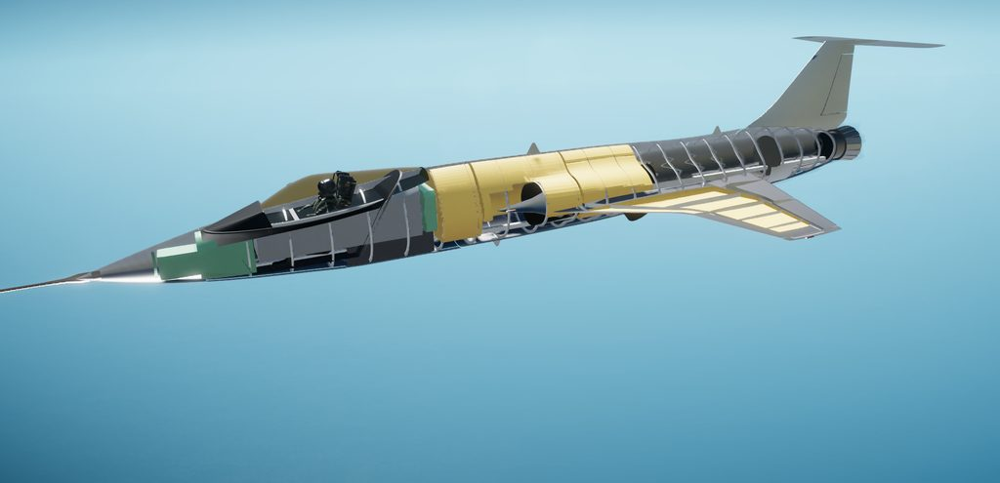
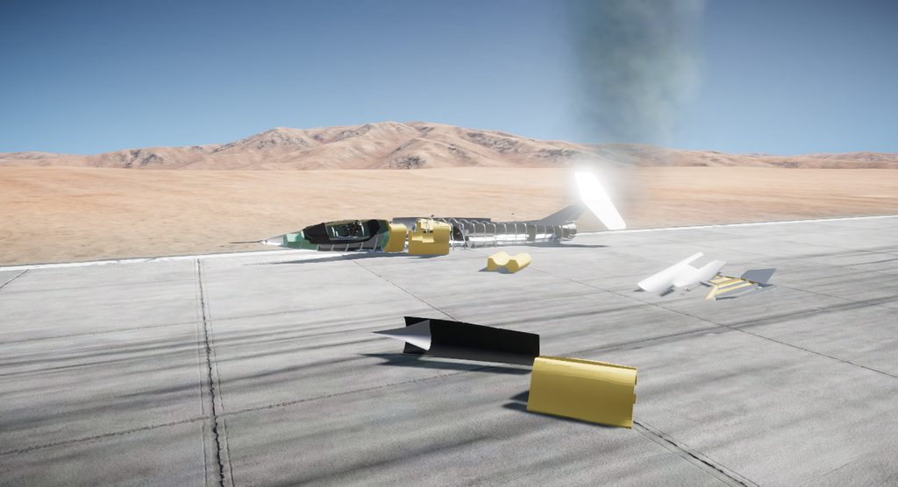
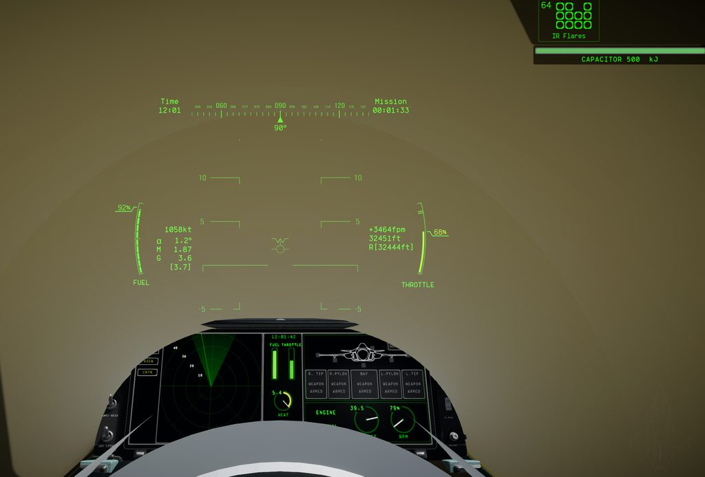

# 003: Blockout and first flight

The silhouette went into Nuclear Option as a rough blockout the same day it was approved. The point was to fly the first-cut flight model before any detail depended on the wing.

## Under the skin

A Full Fidelity aircraft in this game is a tree of breakable parts, so the generator grew a second module for what sits under the skin, laid out like the F-104: radar and avionics in the nose, the cockpit tub, bladder tanks round the intake ducts, the engine core and afterburner, frames, spars and gear bays. Each part carries its mass and tank volume. The skin splits into removable panels over structure cores, 45 parts in all, and every part gets convex collision pieces and a low-detail hull.

The export pipeline, the FBX scrub and a pre-commit privacy check came over from the author's earlier MRB-100 Centurion mod. The export now fails if an internal part cuts through the skin or a fuel cell touches anything but structure.

## Into the game

Unity editor scripts build the jet on the stock FS-12 Revoker and strip its canards, cannon and bays behind twelve checks that fail the build. The plugin brings the Centurion's startup and AI-supply fixes, a driver for the nozzle petals, and the live tuning file. A review before the first flight found eight problems, among them tuning and the nozzle driver losing track of parts once the game unparents them in flight.

Eight playtest scenarios then flew it: runway spawn, takeoff, level speed at 10 and 15 km, afterburner endurance, approach, sustained turn, and a two-player loopback on one PC. A harness launches the game, flies each scenario on its own and returns pass or fail with the evidence. The first runs found problems no render had shown.

- **It broke up at spawn.** The game pushes a gear's spring and damper on its attached part alone, and on the light leg parts the stock dampers flung each leg until its joint broke. Each gear now pushes on the part its leg hangs from, as the Revoker's do.
- **It reared up on its takeoff roll.** The fuselage cores had only thin keel colliders, which gave almost no roll inertia, so the tyres' side force spun the jet. Each core now carries a section-sized box on a layer that never collides.
- **The skins drew inside out.** Most lofts faced inward, and the game culls back faces, so the frames and tanks showed through.
- **Vectoring was almost never on.** The Revoker cuts thrust vectoring above 250 m/s, a speed the Icarus rarely flies below. The cutoff now sits above its top speed.

Once it flew, it reached Mach 2.43 at 10 km against the predicted 2.54, and Mach 2.87 at 60,000 ft, where it porpoised in pitch. It lifted off at about 101 m/s against a target band of 72 to 95. The pilot sat in the Revoker's cockpit until the Icarus got its own.

The aircraft also got its right name here. The first files called it the F-240, a typo for F-204, and a scripted replace over the source and docs fixed it.

Next: research digests of how stock and modded jets are detailed, then the exterior detail.
