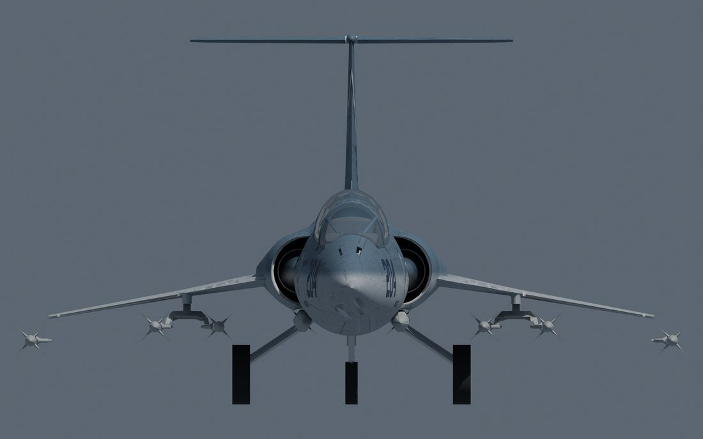
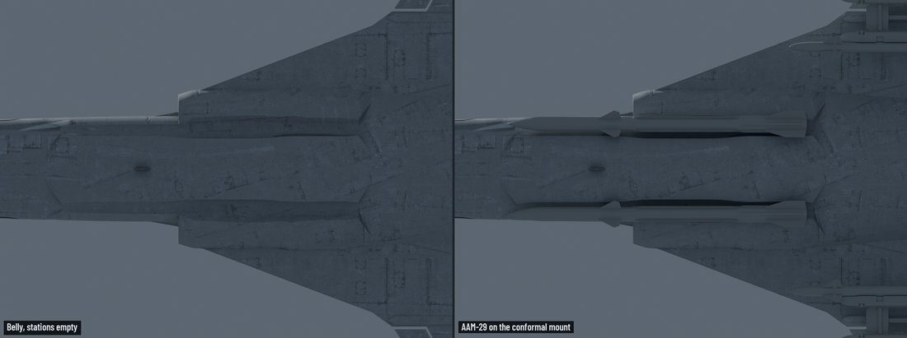
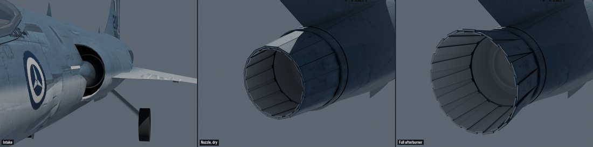

# 004: Exterior detail

The first detail pass started too early. The owner stopped it because it wasn't grounded in how real Nuclear Option aircraft are built, and the work restarted from research.

## Research first

Three digests came back, on the exterior, the cockpit, and stores and hardpoints. Each was drawn from the stock Revoker and Ifrit and from published mods, checked by a completeness critic and revised. They set the rules the rest followed: detail merged into each part's mesh rather than added as loose objects, surface detail in textures rather than geometry, and weapon stations that use the game's own racks and rails. The detail plan went to a GPT-6.1 Sol review (17 findings) and to the owner before any building started.

The detail work then ran as separate packages (airframe, canopy, stations, UV layout, propulsion, lights), each built by Claude Opus or GPT-6.1 Sol in its own copy of the repository. Nothing merged until the owner had seen the renders and the build passed.

## What changed

- **Half the triangles.** The blockout skin carried 56,000 triangles. Regridded, it has 27,000, and the moving surfaces got coves wide enough for their full travel.
- **Canopy.** The pilot's head sat 16 cm under the glass, short of the 23 cm the stock cockpits leave. The eye dropped 40 mm, the hood grew about 40 mm higher and wider, and the glass became an outer and an inner pane.
- **One-piece stabilator.** The two halves left a 14 cm slot behind the fin-tip fairing. It is now one surface tip to tip, on one hinge.
- **Stations.** The outer pylons went, leaving one small pylon a side, 8 cm deep, with every rail's hooks lined up on its flat lower edge. The owner cut the advanced weapons, then brought back the AGM-68 for anti-armour strikes and the AAM-36 Scimitar. A clearance tool sweeps every store against the gear's suspension, its retraction and a nose-up rotation on the runway.

- **Belly trough.** The conformal stations are this mod's own touch. Stock rails there hung the missiles fully exposed, and the retracting main wheel passed through one. Each side now has a shallow trough shaped into the belly, and three low mounts made for the Icarus carry the stock MMR-S3, IRM-S2 and AAM-29 with their game data unchanged.

- **UV atlas.** The skin unwraps into one atlas at a uniform density, with unique islands where markings go, so it can be painted.
- **Intakes and nozzle.** The shock cone got a bleed band. A splitter plate standing off the fuselage was built and then removed, because it looked wrong on the aircraft. The iris nozzle gained a rolled lip, an afterburner interior with a flameholder ring, and chamfered petals.
- **Lights.** The wingtip navigation lights reuse the game's stock lenses, with a check that keeps every tip store clear of them.

Next: the cockpit, which the pilot sees nearly all the time.
