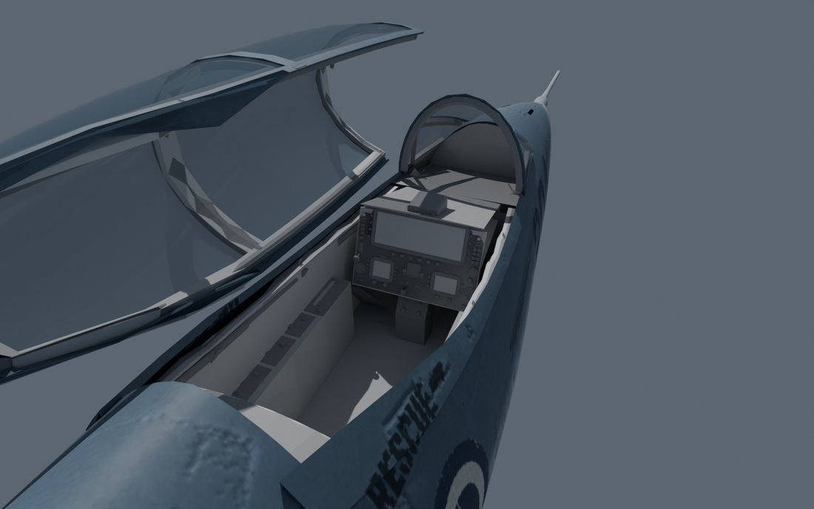
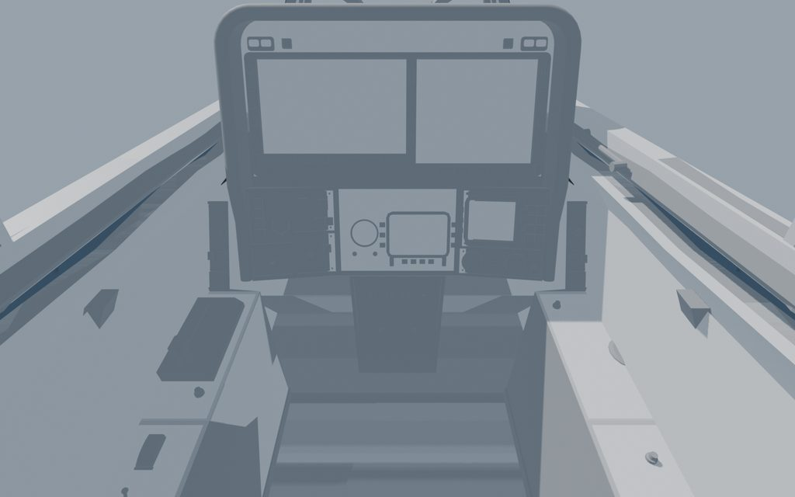
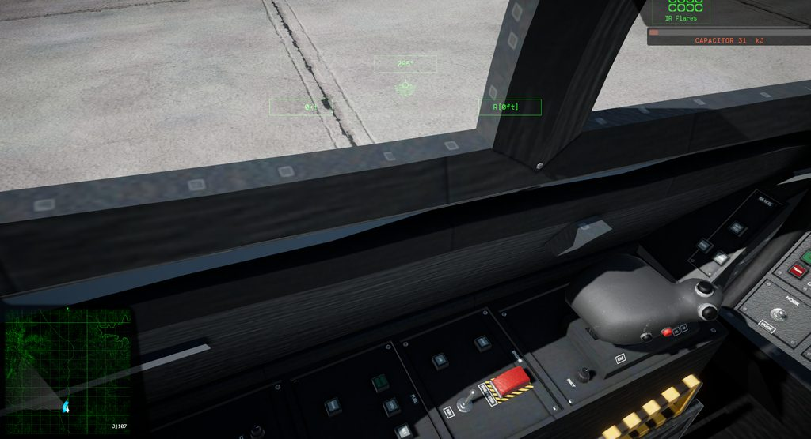

# 005: Cockpit

The cockpit took three rounds and a run of playtest fixes, because players look at the cockpit for most of every flight, so it has to hold up close.

## First pass

The Icarus had been flying with the Revoker's interior. Its own first cockpit was about 12,000 triangles, most of them in 297 small items (switches, bezels, fasteners, placards), plus the tactical screen, warning lamps, inner canopy frames, and the game's stock seat, stick and throttle. Build checks keep it clear of the airframe, the glass, the controls through their travel and the hood through its whole opening, and they hold the sight line over the nose.

It wasn't good enough to sit beside the stock cockpits and the better mods.

## A reference board

So Claude Opus rendered the Revoker, Vortex, Ifrit and three modded cockpits from the same eye point as the Icarus and measured the gaps. The board found no baked shading (ambient occlusion averaging 1.00 against the stock cockpits' 0.46 to 0.61), a flat single-slab panel, an open view into the nose bay, one pale tone everywhere, and labels too small to read.

The rebuild worked to those numbers. It has a hooded panel in several planes with a rim that runs down both sides, baked shading and relief, switches and knobs measured from the stock parts, missile warning lamps in two groups of two where the stock jets put theirs, and four displays whose titles now match what they show. Every measured value landed inside the reference range.

## Flying it

Sitting in it in game found more:

- A tan Y smeared across the glass. The canopy's UVs ran into the opaque border of the stock canopy texture.
- From the pilot's eye a wall showed between the windscreen and the console. The console now rises so the view runs straight from sky to glare shield.
- Sky leaked through gaps round the sills and side consoles. A pilot-eye check now casts rays in every direction and fails the build on any ray that escapes outside the glass.
- The standby attitude ball, fuel gauge and clock were dead. The game's scripts drive only its screens, so a small plugin script now turns the ball to the jet's pitch and roll and moves the needles.
- The stock throttle grip floated over the left console. It now sits on a quadrant.

Next: everything in one build, flown properly.
