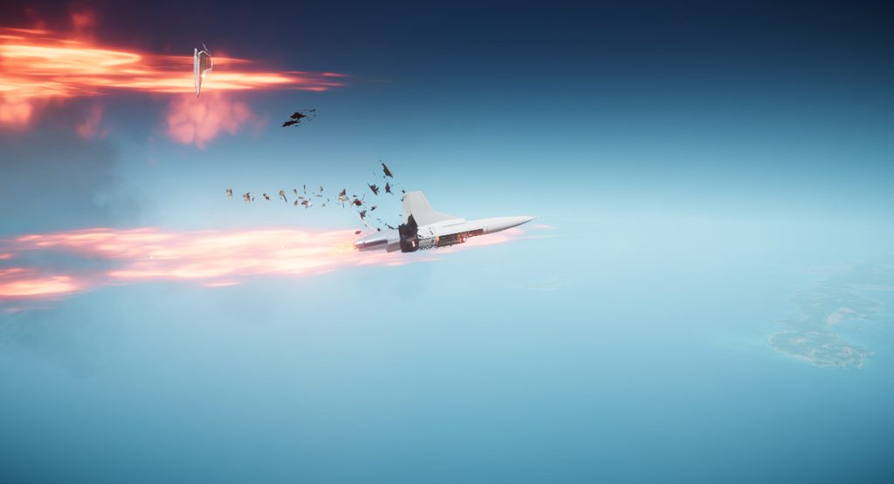
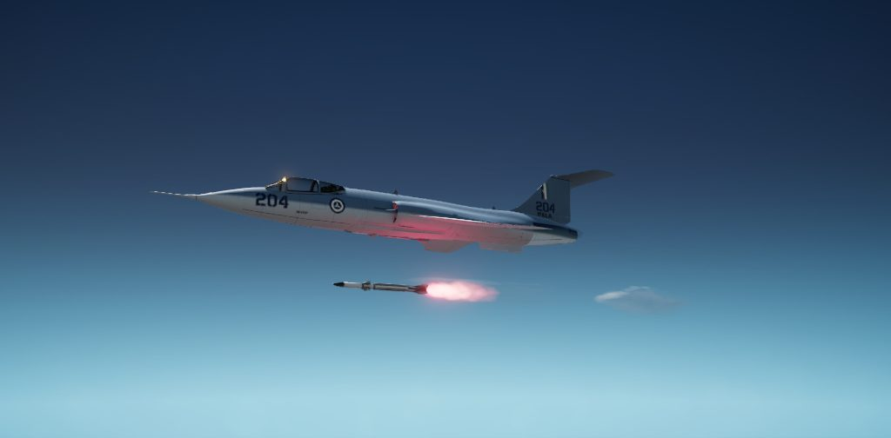

# 006: Integrated build and flight model

With the detail merged, the whole jet went back into the game for a regression pass, then for tuning, and then for the owner to fly.

## Tuning from the trace

Claude Haiku reran the playtest scenarios on the new build. Spawn, the 15 km speed run, the four liveries and a conformal launch passed. Takeoff, approach, the 10 km speed run and the sustained turn failed, as they had since the blockout.

Claude Opus then had the game for twenty minutes, with the live tuning file and the decompiled game code side by side. It found that two of the four failures were the jet and two were the tests:

- **Takeoff** was an AI setting. The game's takeoff pilot waits until 70% of the aircraft's `takeoffSpeed` before pulling, and at full afterburner the Icarus gains 30 m/s while it rotates. Dropping `takeoffSpeed` from 95 to 75 m/s brought liftoff into the target band.
- **Top speed** was drag, about 4% more than the offline replica predicted. A drag area of 0.47 instead of 0.55 gives Mach 2.50 at 10 km and Mach 2.78 at 15 km.
- **Approach and turn** measured the wrong thing. The landing AI's own schedule flies about 116 m/s at 150 m, whatever the aircraft. The turn window held the build-up to 8 g rather than the turn. Over the part of the turn above 8.5 g, the energy loss matched the offline model to within 0.1 m/s².

## Coming apart properly

Then the owner flew it, and the fixes came in from the trace of that session.

- **It spawned damaged.** Its own part colliders touched each other, and 0.06 s after spawn the contact had dealt damage to two parts. The plugin now tells the physics engine to ignore collisions between the Icarus's own parts.
- **A missile took the wings but never the fuselage.** Blast damage reaches only a part whose collider lies on the line from the burst, and each fuselage section had just a thin keel strip. The sections now have shells under the skin, and a missile from behind takes the aft fuselage off in the air within half a second.

- **The tail bent in turns.** In a hard turn the whole fin and stabilator rolled 8 degrees off the fuselage. Each hung by a single joint, which the game's physics solver treats as a soft spring. They now also join the aft fuselage, and at 9 g every tail part stays within 0.3 degrees.
- **Bullets vanished.** Three invisible inertia boxes caught rounds before they reached the skin. The boxes are gone, and the inertia they gave is now set directly.
- **The conformal missiles lit in the trough.** They now drop 1.5 m on a launch rail first, so the motor lights at least 1.1 m below the airframe.

Each fix landed with an in-game scenario that checks it.

Next: the skin, which still read as rough paint.
