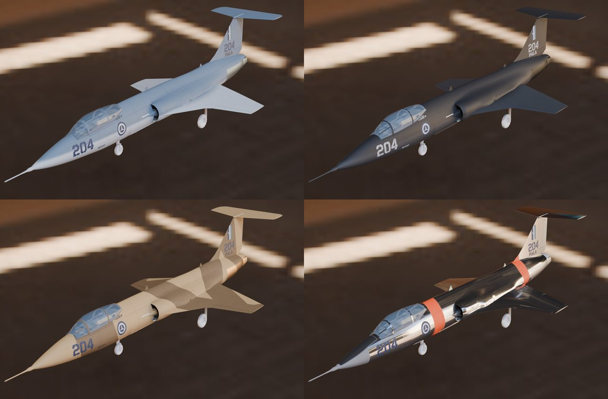
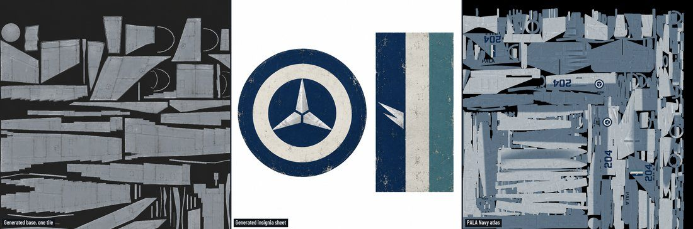
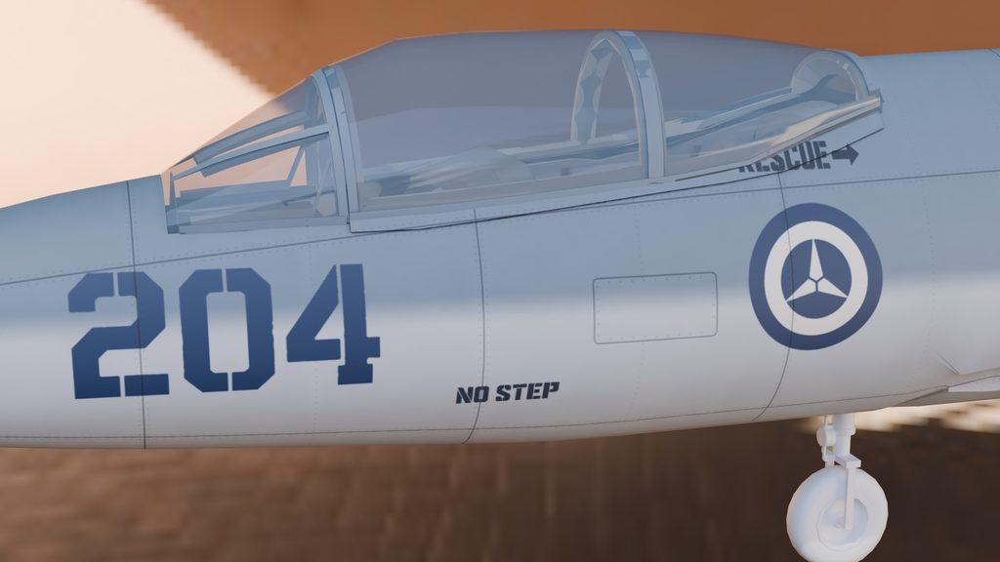

# 007: Liveries and the skin pipeline

The Icarus wears four Primeva (PALA) schemes: Navy, Black, Desert splinter, and Bare Metal with high-visibility bands. The art is image-generated and the placement is scripted, and getting that split right took three rounds.

## Round one: generate the base, script the rest

GPT-6.1 Sol piloted two methods on one livery. Generating the whole atlas as one image gave rich detail, but an upside-down number, a fin flash on the flaps and colour breaks at the seams. Generating plain swatches and projecting them gave clean markings but looked flat. The owner chose both: image generation makes the base, and the markings go on it as scripted decals.

So Codex's built-in image generation painted an unmarked base straight onto crops of the UV layout, and also drew the insignia: an original roundel and fin flash, the digits and the stencils. The only images it was shown were the Icarus's own UV layout and renders, so nothing is traced from the game's art. A script sets each scheme's colours and places the markings only on islands that aren't mirrored, so no number reads backwards. Every generated image sits in [the repo](../../art/textures/generated/) beside the prompt that made it.

## Round two: per-part context

The generated bases didn't fit their parts, because the generator knew little about what it was painting, so the owner asked for much more context on what was being generated. Each part now gets its own context pack: what the part is, where it sits and which way is forward, its size, its real panel layout, the edges of its neighbours, and a style block from the vision. Image generation was also asked to make matching height and roughness maps. All 66 failed an alignment check against their base images, so relief came from the base instead.

## Round three: flat sheet metal

That relief turned paint grain into bumps across every panel, and at 150 pixels per metre a rivet was smaller than a pixel. A Claude Opus art pass measured the stock skins first (108 to 132 pixels per metre on the Revoker, Ifrit and Vortex) and then rebuilt the pipeline:

- the skin maps doubled to 4096 square, 300 pixels per metre
- panel faces became exactly flat, with relief only at frame joints, rivet rows, lap joints and access panels
- the decals print at 16 samples per pixel, so the numbers no longer stair-step
- Bare Metal got its own metallic map, swapped in by the plugin when that livery is chosen

The rebuild is one rerunnable chain. Any change to the skin's shape repacks the atlas, so every geometry merge since then has rerun it and re-baked all four liveries. A later pass laid the panel seams out from the airframe's real structure, so every seam closes into a panel, and a check keeps each decal on clear skin.

Next: the landing gear.
