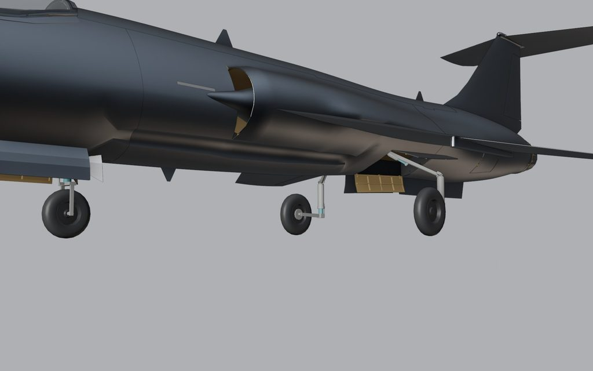
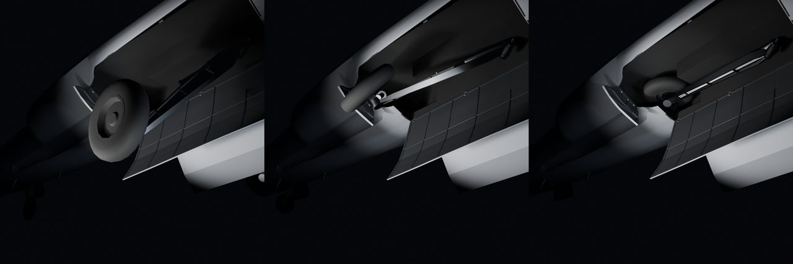
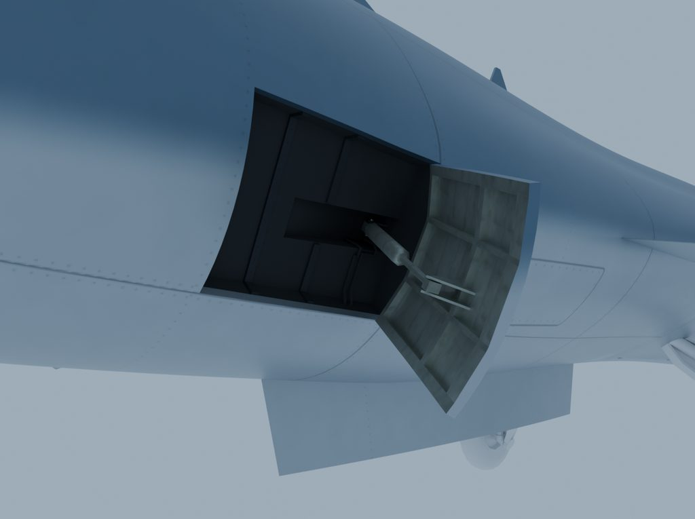

# 008: Gear, doors and mechanisms

The landing gear was built three times. The first version worked, and that wasn't enough: it didn't move like a Starfighter's.

## A fold that fits

The first gear came from a kinematic search. Claude Opus searched hinge positions until the main legs fit their bays, and the answer was an inboard swing with a knee fold, clear of every store across 1,705 tested poses. The owner rejected it on sight: a Starfighter upgrade wouldn't change the gear.

The real F-104's main legs swing forward and inward from a keel pivot while each wheel twists 90 degrees to lie flat, side by side, under the intake ducts. Copied straight, the tyres clashed by about 0.1 m. Working from frames of a video of the real gear, Claude Opus wrote a solver, `tools/gear_fold_solve.py`, that scores candidate hinges against the airframe and every store option. The owner traded space for the fold: flatter duct floors, the conformal stations moved 0.22 m forward, and 80 kg of fuel trimmed. The fold that won clears the wing's twin missile racks by 58 mm.

## A leg that looks loaded

The owner then asked for a leg that looked more mechanical than a plain bar. It got a forging and a working shock strut. A critique of the retraction clip from players on Discord pushed it further, to the F-104's arrangement: one solid leg swinging at its pivot and a diagonal shock strut from the bay roof to the leg, driven by the game's stock constraints with no plugin code. The big aft door scraped the runway in a playtest, so it split into a clamshell, and a build check now fails any door within 0.1 m of the ground.

## Speed brakes

The speed brakes went through the same arc. The first had real wells and an actuator, but the ram ran almost along the panel with a 9 cm lever arm, which made no physical sense. They now close flush on the skin's panel lines, the wells have ribs, rivets and hydraulic lines, and the ram works on an 18 cm arm.

The gear, doors and stores are checked by sweeps that step each through its travel and fail the build on a clash. The strut had no such check until a playtest showed it cutting through the leg as it retracted. Now it has one.

Next: the intakes and the fuel.
