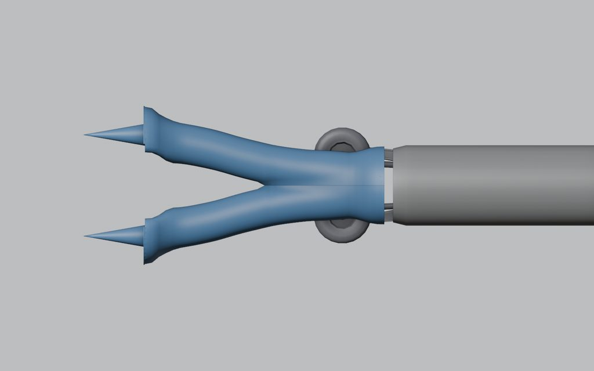
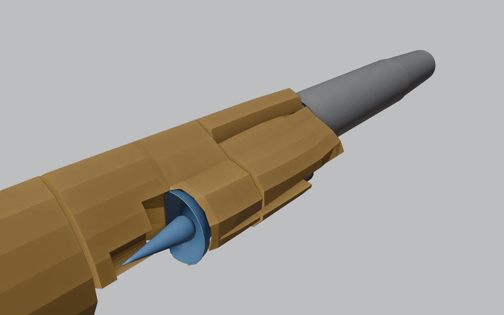
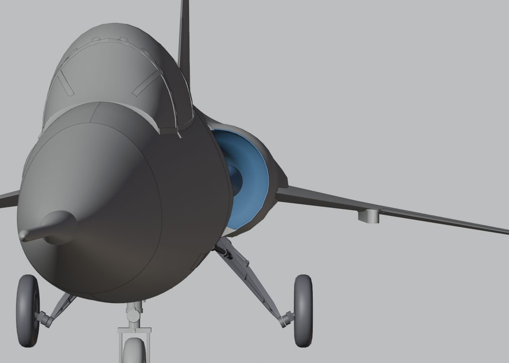

# 009: Intakes and fuel

The blockout carried 2,400 kg of fuel, and the F-104 gear fold trimmed that to 2,320 kg. Three intake changes in one day took it to 3,082 kg, a third more, without changing the outside of the jet.

## One Y-duct

Each intake ran its own wide tube all the way to the engine, filling the fuselage between them. At the owner's request Claude Opus measured the areas and the free volume first, then replaced the pair with one Y-duct: the two ducts curve inboard behind the shock cones and merge into one round trunk on the engine axis, with a smooth growth in flow area from the throat (0.337 m²) to the engine face (0.563 m²). A build check holds that area schedule. The fuel cells grew into the freed space, and the design load rose to 2,650 kg.

## A constant tube and a straight wall

Each shock cone's body ran down the duct behind the lip, so the duct bulged round it and pinched behind its base. In the game that buried cone and the diffuser shape were visual only, and they cost internal space. Each cone now stops just inside its lip, and the duct holds one flow area from just behind the lips through the merge, then grows to the engine face. The cells, rebuilt coarser at half the triangles, took the design load to 3,013 kg.

The last change ran each intake's inboard wall straight from the lip into the tube, with all the narrowing on the outboard side. That added another 69 kg, for 3,082 kg.

## What it changed in flight

More fuel moves the numbers players care about. On paper, full afterburner now lasts about 6.4 minutes instead of 4.8, and the full-fuel centre of gravity sits 65 mm further forward than before the Y-duct. Both are estimates from the build, not flown results. The flight model was tuned in game at the old fuel load, so it gets flown again before release.

Next: the tail and the finishing work.
