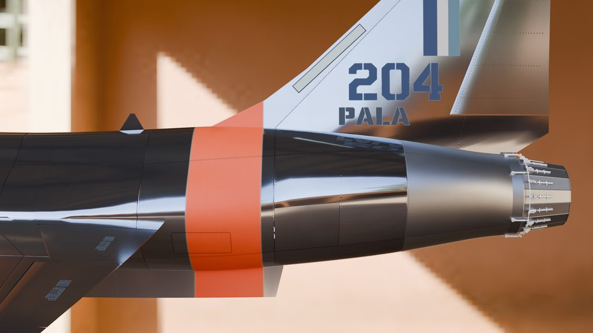
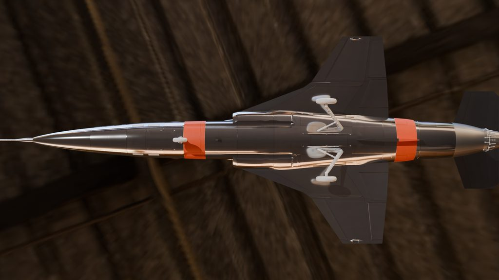

# 010: Sound, tail and finishing

The last stretch was the work a player notices without being able to name: how the jet sounds, whether the tail reads as a Starfighter's, and where the lights and markings sit.

## Its own sound

The Icarus flew with the Revoker's engine. GPT-6.1 Sol searched for public-domain and CC0 recordings and built candidate loops for the owner to audition on a listening page. The first round failed for a reason the author's earlier Centurion mod had already taught: a recording of a jet passing a fixed microphone carries Doppler shift and a front-to-back change, while the game's camera moves with the aircraft. Round two kept only stationary sources, such as hush houses, test stands and engine run-ups.

No cleared stationary J79 recording turned up, so the engine is a public-domain DVIDS hush-house recording of an F110, labelled as a stand-in. It took seven rounds by ear, the later ones built by Claude Opus. The turbine whine went from sounding like an electric fan (about 2 kHz) to a vacuum cleaner (about 400 Hz) before settling at 1,220 Hz at full power, the pitch measured from a reference clip said to be an F-104S climb, whose source is unverified. The reheat needs 9.5 dB more than its file can hold without clipping, so the plugin raises it after the game's volume limit. The gear travel, gear lock and belly scrape are new too, resynthesized with Earshot from CC0 recordings. Every source is in [the credits](../../unity/Assets/Blueprinter/Mods/icarus/Audio/CREDITS.md). The reference clip only guided the ear, and none of it ships.

## The T-tail

The fin and its tip pod didn't read as an F-104's: the fin tip had about 1.0 m of chord where the F-104's has 1.37 m, and the pod was a short round cap. Against the three-view in NASA TN D-6943, the fin now has the F-104's upright trailing edge and full tip chord, and the pod is a pointed, flat-sided blade 1.85 m long. The stabilator keeps the owner's squared-off trailing edge, and its root slides along the pod's flat sides through the whole ±15 degree travel.

## Finishing

- **Lights.** The wingtip navigation lights now show above and below the wing, with a ray check against the angles in the FAR 25.1385 to 25.1389 rules. A white tail light sits on the stabilator's trailing edge, and the formation lights are recessed into the skin at stock size.
- **Markings.** NO STEP moved onto the wing roots and control surfaces, the bare-metal band on the tail shrank to the last panel ring, the radome came unpainted and the nose probe went bare metal in every livery.
- **Conformal troughs.** The empty troughs' ends became NACA-style ramps, and their edges were straightened so the skin round them shades cleanly.
- **Icons.** The map and the plane select screen show the Icarus's own outline instead of a placeholder.

Next: droppable tip tanks on the wingtip stations, then a release build flown on two PCs.
