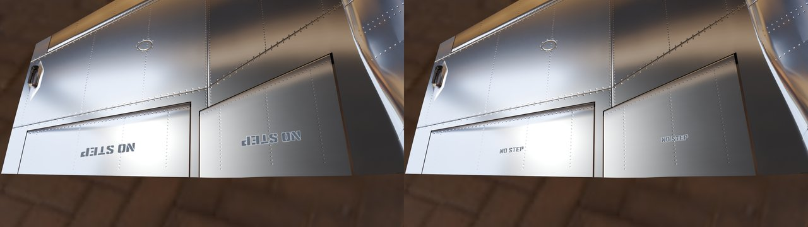
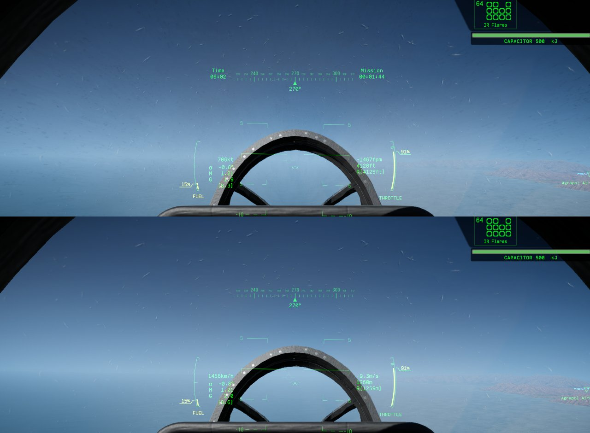
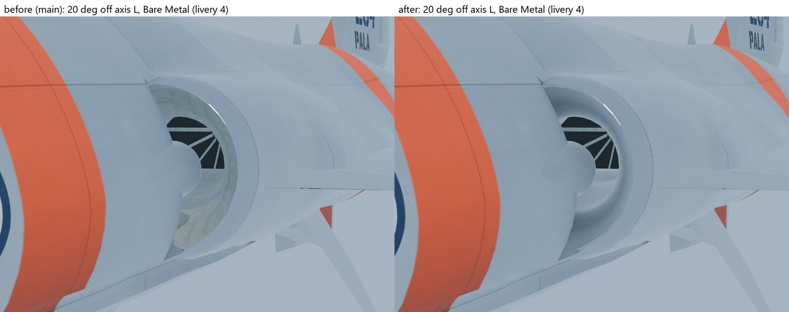
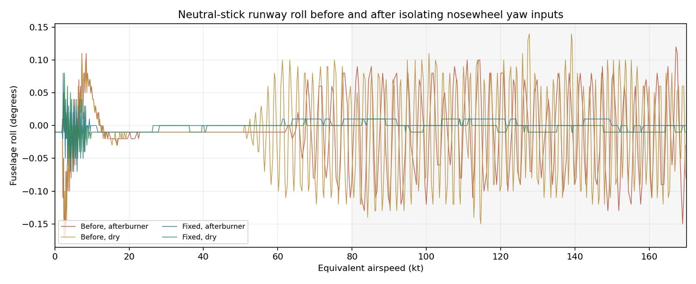

# 011: Fixes from flying it

With the finishing work merged, the owner flew the Icarus and reported five problems: a light that didn't move, stencils that read upside down, a jet that came apart in hard pulls, a canopy that went white towards the sun and a wobble on the runway. Feedback on Discord added the intakes.

## The tail light rides the hinge

In the owner's playtest the white tail light and its fairing stayed put while the stabilator turned. Both hung from the stabilator part, but the game turns a hinge object under that part, not the part itself. Claude Opus moved the lamp and fairing onto `stabilator_hinge`, and the build check now fails if either leaves it.

## NO STEP, the right way up

The owner's screenshot showed the NO STEP stencils backwards and far too big. Claude Opus found that every one of the six read upside down from behind the wing, where a person stands to step near the flaps, and stood 70 mm tall. The flap and aileron stencils now read from behind the trailing edge. The wing-root one turns a quarter to read from outboard, facing the fuselage.

All six are now 38 mm (1.5 in) capitals at the stencil sheet's own proportions. The USAF markings manual, T.O. 1-1-4, sets stencilled instructions at 1/2 to 2 in, and 38 mm is the smallest size whose strokes span two of the wing's 3.5 mm texels. No written rule turned up for which way NO STEP faces, so the trailing-edge reading follows where a maintainer approaches the flaps from and is unchecked against a real F-104.

## One piece under full-stick pulls

The owner felt the wings broke off too easily, and pointed out that the game doesn't break most jets from G alone. In a hard turn, players worry about the pilot blacking out. Claude Opus found the wings weren't the first to go. Above Mach 1 a full-stick pull tore the aft section, the engine and T-tail, off an undamaged Icarus at 7.3 to 8.4 g. The tailless jet then tumbled and shed its wings within seconds, while in the pull itself the wings had reached only 0.55 to 0.60 of their limit.

The game has no G rule. It breaks a joint only past its limit, and damage lowers that limit. Above Mach 1 the stabilator pushes down hard on the aft section's joint, so its load climbs faster than G. The aft section and each wing spar hang on one joint that takes the whole bending moment, so they now get the Revoker's fuselage-joint strength, 100 kN, up from 50 and 60. Full-stick pulls at Mach 1.25 low down and Mach 2.2 at 10 km now peak at 0.67 of any joint's limit, and gun and missile hits still break parts off.

That fix broke one test. A missile kill still tore off the left wing spar, the engine core, the stabilator, the rudder and more, but the undamaged aft fuselage now stayed on through the tumble that followed, and the test expected a fuselage section to come off. Strength alone can't give both, because a full-stick pull loads the aft section about as hard as that tumble did. The owner chose stock behaviour over a new break-after-death mechanism, so the test now passes when a primary structural part (a wing spar, the engine core or a fuselage section) comes off in the air. The README still calls the damage model a first pass that needs balancing.

## Canopy glare

Flying towards a low sun, the owner couldn't see out at all, through what looked like a golden reflection on the inside of the canopy. Claude Opus found it wasn't a reflection. The stock inner-glass material carries a grime layer that lights up as a veil across the whole canopy. Probe runs settled it: with the grime at zero the veil went, while zero smoothness or no scratches left it there. The Revoker uses the same material, so matching stock would have kept the veil. The gold tint is most likely that grime lit through the glass's tan-brown base, though no run reproduced a gold cast.

A mod copy of the material couldn't fix it, because Blueprinter can't patch the game's glass textures into a mod material. A first attempt drew untextured and lost the crack texture. So the plugin takes the grime off each Icarus's own copy of the pane material, the copy the game also cracks, and the tint, scratches, frames and cracking stay. Scripted sun sweeps at 09:00 and 17:00, eight headings and four view directions each, show no veil.

## Intakes finished in skin

Inside the intakes, the duct walls, the mouth and its corner sheets wore the stock mechanical trim: painted plates, ribs and pipes, mapped flat from three sides. The duct read as exposed structure in a patchwork, where a turbine intake is smooth and finished like the outside. Claude Opus moved them onto the skin, with no panel lines and baked shading that darkens towards the engine face. The main wheel-well roof, which stood up through the duct floor where the duct dips, is now cut clear with a 10 mm gap. The exterior went from 87,557 triangles to 87,927.

## The runway wobble

The owner saw the jet wobble on the runway above 100 kt. GPT-6.1 Sol measured it against the stock Revoker on the same runway: from about 60 kt the Icarus rocked in roll at 7 Hz, 0.2 to 0.3 degrees peak to peak, bounded up to 170 kt, while the Revoker stayed within about 0.01 degrees. It couldn't reproduce a 100 kt onset or a severe wobble, and it ranked the likely causes without proving any.

Sol then isolated it with runs that each cut one path. Feeding the nosewheel the pilot's raw yaw alone stopped the cycle (0.03 degrees), and turning off yaw thrust vectoring didn't (0.28 degrees). The fly-by-wire's yaw damper, meant for flight, was steering the nosewheel through the shared control inputs, which closed a loop through the tyre forces. The nosewheel now takes the pilot's raw yaw, and the rudder and thrust vectoring keep the filtered command. The roll span falls to 0.02 degrees with no cycle up to 170 kt, and a cruise, a 4 g pull and a takeoff fly as before.

Next: the tip tanks, and getting the repository ready to go public.
