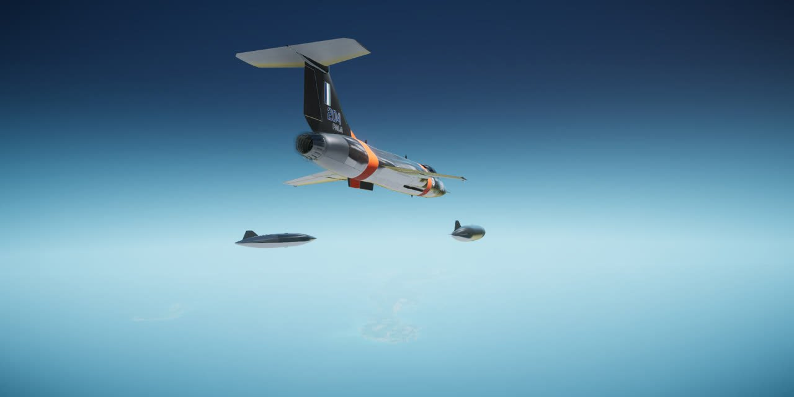

# 012: Tip tanks, and getting ready to go public

The last aircraft feature was the F-104's signature tip tanks. After that the work turned to the repository itself: pictures for the README, preparing the repository for public release, and the release scripts.

## Tip tanks

The wingtips carried only missile rails. Claude Opus gave each one a droppable tip tank or a missile rail. Each tank holds 170 US gal, 500 kg of fuel, which matches published F-104G data. No official dimensions turned up, so the 5.44 m body is scaled from a quarter-scale replica and is an estimate. At the owner's call, the default Interceptor loadout carries the tanks.

The tanks feed before the internal cells, and the fuel gauge, the aircraft's mass and the AI's fuel check all count them. One trigger pull on the station drops the pair with whatever fuel is left in them, an AI pilot drops them once they run dry, and they can't release with the gear down or on the ground. With the tanks fitted, the jet still strikes its tail at 10.5 degrees nose-up before a tank touches the runway at 12.2, and the wingtip navigation lights stay clear in every direction. A scripted run of 43 steps passed: the tanks fed first, read on the gauge and dropped clean.

One thing that run didn't check was paint. A dropped tank fell plain white whatever the livery. On release the game hides the hanging store and spawns a separate falling round on every machine, and only the hanging store had been painted. The plugin now dresses the round as it starts, with the livery and light state of the wing it left, through the code that paints the hanging tank. Bare Metal and Desert tanks keep their finish as they fall.

## Pictures that move

The README had three renders and nothing in motion. Claude Haiku scripted in-game clips across all four liveries: a low afterburner pass in Bare Metal, the standby ball turning through a roll, the Desert jet parked at Sandrift, the gear cycling, a conformal AAM-29 dropping and lighting, and an afterburner takeoff in Black. Its first flyby came out as a banked climb with the gear down, so the hero shot is a second take.

The tip tank release was harder to film. Window recording failed, so Claude Haiku built a slow-motion GIF from the game's own screenshots, but the camera had to sit 60 m back to keep the falling tanks in frame, which made the jet small. The README uses two close stills instead.

## Multiplayer

Two-PC multiplayer is still untested. The plan in [010](010-tail-finishing.md) was a release flown on two PCs, and that hasn't happened yet. Multiplayer is tested only with host and client on one PC, and the README says so. That test had a flaw of its own. Its checks for log lines that must not appear filtered on "F-240 Icarus II", while the plugin logs as "F-204 Icarus II", so they watched nothing and could not fail. They now use the plugin's real name. Claude Sonnet also changed the test harness so that a log check naming a source nothing logs ends the run as inconclusive.

## Public release

The repository was prepared for public release. BUILD.md now covers Git LFS, `ICARUS_BLENDER` and the Python packages the model rebuild needs, and the build finds the game in the Steam libraries and Blender through `ICARUS_BLENDER` or PATH. The README and changelog name the five stock operations, call the endurance an estimate, date the Mach figures and limit the airframe claim to the full-stick pulls it was tested in. The built bundle holds only the mod's own meshes, textures and sounds plus standard Unity shaders.

## Packaging

GPT-6.1 Sol ported the release scripts from the author's earlier Centurion mod. `Package-Release` refuses a dirty tree, checks that the plugin, the Blueprinter mod and the changelog agree on the version, and builds from the release commit. It writes a mod-manager ZIP and a plugin-only ZIP from an allowlist (the DLL, the bundle, the licence, the README and the credits) with checksums and a `meta.json` naming Blueprinter as a dependency. Zipping the same binaries twice gives identical archives, but Unity rebuilds aren't byte-identical, so a release records the hashes of what it ships. `Verify-Release` checks a package, and `Publish-Release` uploads a verified one to a draft prerelease. [RELEASE.md](../RELEASE.md) has the steps.

Installing the plugin-only ZIP the way a player would passed in game, and turned up one trap. With a second copy of the bundle anywhere under `BepInEx/plugins`, Blueprinter skips the duplicate and registers no Icarus at all. The README's install steps now say to keep a single copy.

Next: version 0.0.1 as a prerelease, then multiplayer flown on two PCs.
