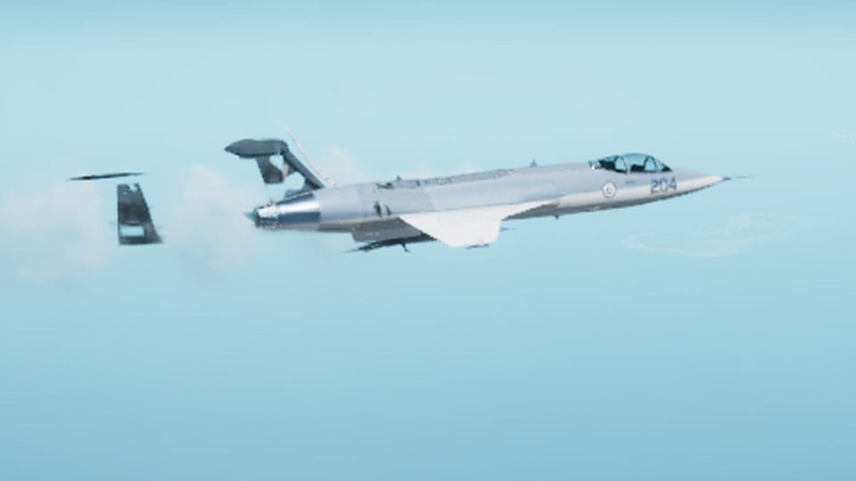

# 013: A finer breakup

In 0.1.0 a missile hit took the Icarus apart in a few big lumps: a whole wing, or the aft fuselage, engine and tail as one 1.4 t piece. For 0.2.0 the mod cuts the airframe into 64 parts, and the wings, the tail and the fuselage skin each come apart in several pieces. In a test missile hit, 13 parts broke off on their own.

## Where it splits

Each wing splits at the crank into an inner and an outer box. The outer box carries its share of the lift, so losing it rolls the jet. The wing skin is four panels a side, inner and outer, upper and lower, so a hit can strip a panel and leave the box under it.

The tail cone breaks away behind the engine, taking the speed brakes with it. The afterburner and nozzle separate from the engine core, and losing them kills the engine.

On the fuselage, the side panels part at the lower lap joint and at the mid frame, and the dorsal cover splits in two. The frame and stringer truss over the top comes away in two halves, which shows the fuel tanks under it.

The cuts follow the existing texture layout, so every livery looks the same as before on an undamaged jet.

## Braces keep it stiff

More pieces means more joints, and the game's joints flex. With the tail cut free, the pieces behind the engine sagged in a 9 g pull and turned the fin by more than a degree. Braces now tie the tail cone, engine core and fin to the main fuselage, and the outer wing box to the wing root, as the game does on stock airframes. Each part keeps its share of the mass where it was, so the balance is the same as in 0.1.0.

## Seams that don't open

Even braced, an attached piece moves a few millimetres against its neighbour in a hard pull: up to 8 mm at the wing crank, 3.5 mm on a fuselage panel. That is enough to open a visible gap in the skin. So while a piece is attached, the mod draws it locked to the part it hangs from: the outer wing and everything on it to the inner box, the tail cone to the aft fuselage, the afterburner and nozzle to the tail cone, and each fuselage panel to its core. The lock is only in the drawing. The physics still flexes and breaks as before. The moment a joint in the chain breaks, the piece is drawn where its own body is and falls away.

## The same breakup for every player

In multiplayer each player's game simulates their own jet and tells the others which parts came off. The mod now logs every part that comes away, with the id the game's damage messages use. A two-player test checks that the host and the client see the same parts break off both their jets. A rearm test checks that ten rearms in a row keep the game's list of detached parts and the mod's in step. The two-player test runs host and client on one PC. The test across two PCs is still to come.

## Known limitation

Each of the 64 parts is its own physics body with its own collision shapes, and many of them sit within millimetres of each other. With many Icarus in the air at once, the physics engine has more work each step than with a stock jet, so frame time is somewhat higher, and the cost grows with each Icarus in the air.
