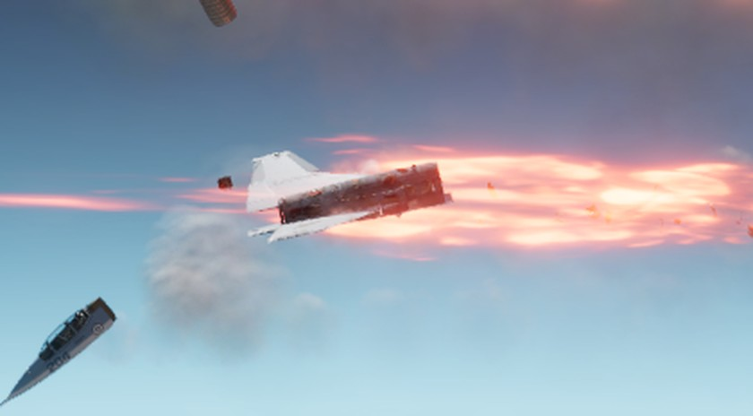

# 014: Built like a stock jet

The finer breakup in [013](013-breakup-split.md) cut the Icarus into 64 parts: skin panels over a frame and stringer truss, with the fuel cells, intake ducts, avionics and engine as parts of their own inside it. In play it came apart badly. For 0.2.0 the Icarus is built the way the game builds its own jets instead, and it is down to 26 parts.

## Freed pieces passed through the jet

Every part of the Icarus ignored collisions with every other part of the same jet, for its whole life. That kept neighbouring parts from fighting each other while attached, but once a part broke free it passed through whatever was in its way, so an engine could slide out through an intact fuselage.

The stock jets do it differently. Parts that share a joint don't collide, through the joint itself, and parts with no joint between them have collision shapes that don't touch. The Icarus now follows the same rule: the collision shapes of unjointed parts are cut back until they clear each other, and the blanket ignore is gone. A piece that breaks off now strikes the airframe and tumbles away.

## Panels and internals that weren't stock

With collisions on, the loose skin panels showed their problem. A panel wraps round the fuselage, so a freed one caught on the structure and scraped along it instead of falling away. The panels' many small collision shapes also hid everything under them from blasts. The game sends a separate blast fragment at each part, and a fragment stops after passing through 10 collision shapes, so missile hits stripped the skin and left the truss and fuel cells untouched.

The internals had their own version of it. A fuel cell whose joint broke inside the centre section, which never comes off, had no way out and stayed wedged there, scraping. A player also reported that full afterburner could tear the engine off. The nozzle carried the thrust, so it reached the airframe through the nozzle, afterburner and engine joints, and enough of it broke them.

The stock Revoker has none of these parts. Each of its 28 parts is a chunk of structure with its skin built in. Its fuel tanks live on the fuselage and wing parts, and its nozzle rides the tail part. So the Icarus now does the same:

- Each skin panel is part of the section it hung on, and the fuselage and wings break up in whole sections.
- The frames and stringers are gone. A broken section shows the inside of its skin, as a stock jet's does, and the jet draws about 12,000 fewer triangles.
- The fuel cells, ducts, radar and avionics are part of the section they sit in, and so are the engine, afterburner and nozzle, which ride the aft section. The thrust goes straight into it, and the engine dies with it.
- Every part takes the stock armour of the Revoker part it is based on.

The fuel total and the balance, empty and full, are unchanged.

## A jump at every origin shift

One hard pull still went wrong: in a fast roll a wing struck the aft section and damaged itself. The cause was the game's floating origin. Every few seconds at speed, the game moves the whole world back toward the origin and copies each object's drawn position into its physics body. The drawn position lags the physics by part of a step, and each part of a fast-rolling jet lags by a different amount, so the wings landed up to 13 cm out of place for one step and the joints snapped them into the aft section. The mod now puts each part of the Icarus back where the physics had it after every shift. With that, the wings move less than a millimetre toward the aft section in hard pulls.

## The same breakup for every player

The nose section's targeting camera had no screen set. When the nose came off, the camera threw an error that ended the breakup before the other players' games heard of it, so they kept parts the host had lost. The camera now paints the tac screen, and the multiplayer breakup test passes again.
