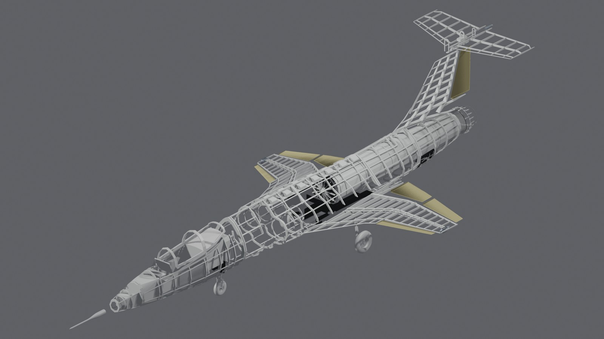
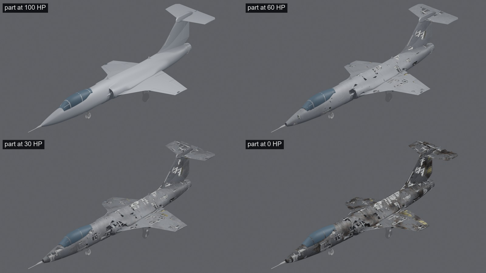
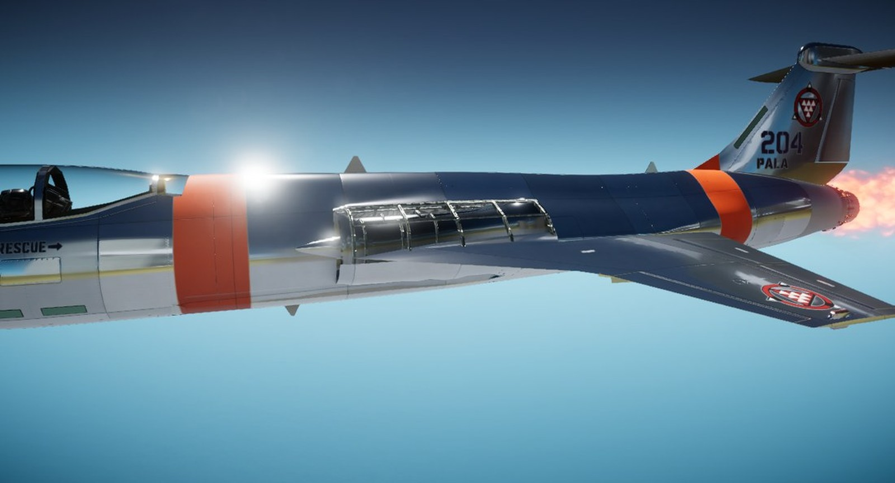
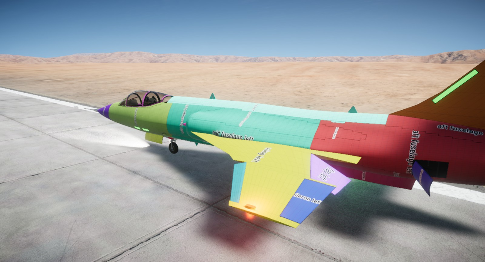

# 015: What shows through the skin

In [014](014-stock-sections.md) the Icarus began to break up in whole sections like the Revoker. A hole in the skin still showed mostly the other side of the skin. For 0.4.0 there are fuselage frames and stringers, ribs and spars in the wing and tail, and structure around the intake ducts. They ride in the same meshes as the sections they belong to. The visible fuel bladders are gone. As on the stock jets, the fuel tanks are part of the fuselage and wing sections.

## An intake has to fall clear

The first detachable intake was the duct inside the fuselage. Its joint could break and the duct would stay wedged in the jet. The Revoker's intake is an outside piece with its own skin and collision hull, so it can leave the airframe. On the Icarus that piece is the cowl lip and the fairing skin behind it, cut along the panel lines. When it comes off, the duct, shock cone and frames stay behind. Each intake can stop the engine, as can the centre section, aft section and tail cone.

## Where blast and fire go

The first intake split also left the centre fuselage with six collision hulls. The game's `DamageEffects.BlastFrag` aims a trace at the origin of each collider it finds in reach. Hulls on the same part share an origin, and `FragTrace` only damages the collider the trace was aimed at. A trace can therefore reach one hull and miss the other pieces whose traces aim at the same point. The main tank went unlit when blast missed the centre section.

The outside intake lets the centre section use a single hull with the origin inside it, as the stock jet does. The main tank lit in both missile-hit runs on that build. The forward tank had the opposite problem. `FuelTank.IgnitionEffects` starts the fire at the part's origin, which was under the pilot. That origin now sits behind the seat bulkhead at the fuel cell, 1.86 m from the pilot's eye.

## A second joint for the nose

The Icarus's 1.9 t nose hung from one joint. A blast that shoved the wings and tail could twist that joint apart even with the forward section at full health. In matched tests the Icarus lost the whole nose in 8 of 15 hits, and the Revoker lost its forward section in 0 of 15.

The Revoker also ties its cockpit to the centre fuselage. The Icarus now has the same brace, rated at 64 kN for the mass it carries. Nose loss fell to 7 of 72 hits, about one in ten. Those losses came from bursts close enough to damage the forward section itself.

## The pilot and the paint

The pilot sat behind the canopy's middle frame. The seat moves 0.75 m forward and reclines 10 degrees, putting the helmet between the frames. The panel shrinks and moves 3 cm down to fit the narrower part of the cockpit. [Cockpit position report](https://github.com/baanish/F-204-Icarus-II/issues/3)

Stock jets carry their side's roundels on the fin and wings. The Icarus now does the same, with four Primeva liveries and three of Boscali's own. The roundel images stay out of the repository. The build reads them from the game and paints them onto the exported liveries. The first aircraft preview wears the side's Bare Metal. The four original livery indices stay in place so saved missions keep their paint.

A texture bake can look fine as a flat image yet come out scrambled on the jet if the model's atlas packs the skin pieces differently. The model export and bake now each record a fingerprint of the skin's texture coordinates. Composing the textures or painting the roundels stops if the fingerprints differ. The [livery kit](../livery-kit/README.md) gives painters that same layout as a 3D model and flat templates.

## What it costs to draw and fly

The 0.4.0 build before the cockpit brace showed no measurable frame-time change against the released 0.3.0. These are median 95th-percentile frame times over three alternated runs, with the range of the runs in parentheses. The aircraft were intact.

| Aircraft | 0.3.0 | 0.4.0 |
| --- | --- | --- |
| One Icarus | 2.543 ms (2.510 to 2.621) | 2.573 ms (2.434 to 2.675) |
| Eight Icarus | 3.633 ms (3.534 to 3.889) | 3.645 ms (3.579 to 3.668) |

The eight-aircraft difference works out to about 0.002 ms per jet, with a 90% interval of -0.039 to 0.017 ms.
